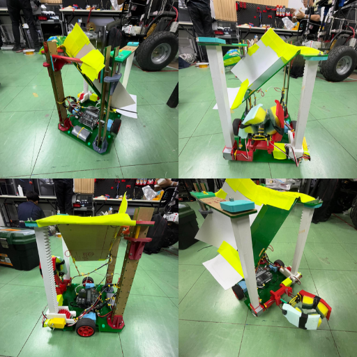
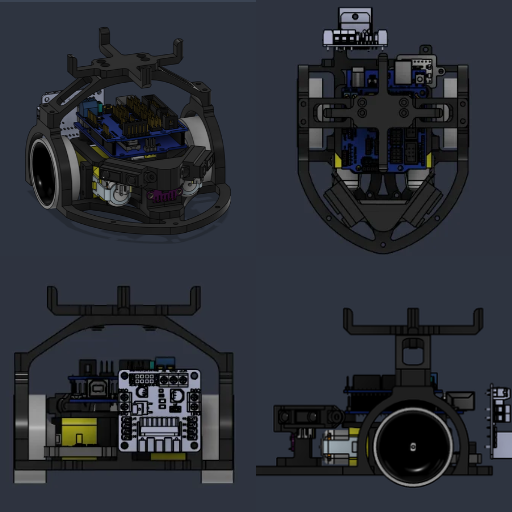

# 🤖 RAI – Robotics Competition AY26/S1 Project

<p align="center">   
     
     
     
    
   
</p>

<p align="center">   A robotics project developed for the <b>RAI 2026 Computer Programming Competition</b>.   \br>   Featuring two independently developed robotic systems: Manual Control and Autonomous Navigation. </p>

---

# 📖 About The Project

**RAI26 Robotics Project** is a robotics engineering and programming project developed for the RAI 2026 Computer Programming Competition.

The project consists of two robotic systems designed to demonstrate different approaches to robotic movement, control, and navigation.

## Report - https://github.com/TONMAIIII/RAI26-CP-PROJECT/blob/main/Compro2026Report.pdf

### 🤖 Robot Systems

| Robot            | Main Function                                   | Programming Platform |
| :--------------- | :---------------------------------------------- | :------------------- |
| Manual Robot     | Wireless operator-controlled movement           | mBlock               |
| Autonomous Robot | Autonomous wall tracking and obstacle detection | Arduino IDE (C++)    |

### 🎯 Project Objectives

- Develop robotic systems for manual and autonomous operation.
- Apply programming concepts to real-world robotics.
- Integrate electronic components, sensors, and motor control systems.
- Implement reliable movement and navigation algorithms.
- Improve control accuracy and system responsiveness.
- Demonstrate practical engineering and problem-solving skills.

---

# 🤖 1. Manual Robot

<details>
<summary><b>View Manual Robot Details</b></summary>

## Overview

The Manual Robot is designed to be operated through a wireless control system, allowing an operator to control the robot's movement in real time.

The robot receives commands from its controller and translates them into motor movements to perform the requested actions.

The system focuses on responsive movement, reliable wireless communication, and accurate motor control.

## ✨ Key Features

| Feature           | Description                                      |
| :---------------- | :----------------------------------------------- |
| Wireless Control  | Allows an operator to control the robot remotely |
| Forward Movement  | Moves the robot forward                          |
| Backward Movement | Moves the robot backward                         |
| Left Turn         | Controls the robot to turn left                  |
| Right Turn        | Controls the robot to turn right                 |
| Motor Control     | Controls motor direction and movement            |
| Manual Operation  | Movement is controlled directly by the operator  |

*Features should be confirmed against the actual mBlock program.*

## 🧰 Hardware & Components

The following table describes the expected hardware categories. Exact models and specifications should be added after checking the physical robot.

| Component                    | Function                                           |
| :--------------------------- | :------------------------------------------------- |
| Main Controller              | Processes wireless commands and controls the robot |
| Wireless Controller / Module | Receives operator commands                         |
| DC Motors                    | Provides movement                                  |
| Motor Driver                 | Controls motor direction and speed                 |
| Wheels                       | Provides traction and movement                     |
| Robot Chassis                | Supports the electronic and mechanical components  |
| Battery                      | Supplies electrical power                          |
| Additional Components        | To be confirmed                                    |

## 🔌 Pin Configuration

The pin configuration depends on the actual controller and motor driver used by the Manual Robot.

| Component             | Controller Pin  | Function               |
| :-------------------- | :-------------- | :--------------------- |
| Left Motor            | To be confirmed | Left motor control     |
| Right Motor           | To be confirmed | Right motor control    |
| Wireless Module       | To be confirmed | Wireless communication |
| Additional Components | To be confirmed | Additional functions   |

## 🧠 Manual Control System

The Manual Robot operates using a wireless command-based control system.

The general control process is:

1. The operator sends a movement command using the wireless controller.
2. The controller receives the command.
3. The program processes the received command.
4. The motor driver receives the corresponding control signals.
5. The motors move according to the selected direction.

### Movement Control

| Command  | Robot Action     |
| :------- | :--------------- |
| Forward  | Moves forward    |
| Backward | Moves backward   |
| Left     | Turns left       |
| Right    | Turns right      |
| Stop     | Stops the motors |

*The actual commands and movement logic will be documented after inspecting the mBlock project.*

## 💻 Software & Programming

The Manual Robot program is developed using **mBlock**, a visual programming environment based on block-based programming.

The project file is stored in the `.mblock` format.

To open the project:

1. Install or open mBlock.
2. Open the Manual Robot project file.
3. Connect the appropriate controller.
4. Select the correct device and communication port.
5. Upload or run the program according to the controller's supported mode.

**Project file:** `rai_manual.mblock` 

</details>

---

# 🤖 2. Autonomous Robot

<details>
<summary><b>View Autonomous Robot Details</b></summary>

## Overview

The **RAI26 Autonomous Robot** is an Arduino-based robotics project designed to navigate its environment using distance sensors and motor control algorithms.

The robot uses multiple analog distance sensors to detect surrounding walls and obstacles. Based on sensor readings, the control system adjusts the speed of its left and right motors to maintain a target distance from the wall.

The firmware implements a PD-style control algorithm to improve movement accuracy and responsiveness.

## 🎯 Project Objectives

- Develop an autonomous robotic navigation system.
- Implement wall-following algorithms.
- Improve movement accuracy using PD control.
- Integrate distance sensors with motor control.
- Develop reliable real-time hardware and software interaction.

## ✨ Key Features

| Feature                  | Description                                        |
| :----------------------- | :------------------------------------------------- |
| Autonomous Wall Tracking | Follows either the left or right wall              |
| Distance Detection       | Measures distance using analog sensor readings     |
| PD Motor Control         | Adjusts motor speed based on tracking error        |
| Obstacle Detection       | Responds to front sensor readings                  |
| Dual Motor Control       | Independently controls left and right motors       |
| Buzzer System            | Provides startup sounds and warning signals        |
| Sensor Monitoring        | Displays sensor information through Serial Monitor |

## 🧰 Hardware & Components

The following components are identified from the current firmware. Exact hardware models should be added when confirmed.

| Component                | Function                           |
| :----------------------- | :--------------------------------- |
| Arduino-compatible board | Main controller                    |
| DC Motors                | Robot movement                     |
| Motor Driver             | Controls motor direction and speed |
| Left Distance Sensor     | Left-side distance measurement     |
| Right Distance Sensor    | Right-side distance measurement    |
| Front Distance Sensor    | Front obstacle detection           |
| Middle Sensor            | Additional analog sensor input     |
| Buzzer                   | Audio feedback                     |
| Battery                  | Power supply                       |

## 🔌 Pin Configuration

The following pin assignments are defined in the source code.

### Motor Driver

| Pin | Arduino Pin | Function              |
| :-- | :---------- | :-------------------- |
| ENA | D11         | Left motor PWM        |
| IN1 | D10         | Left motor direction  |
| IN2 | D8          | Left motor direction  |
| ENB | D6          | Right motor PWM       |
| IN3 | D9          | Right motor direction |
| IN4 | D5          | Right motor direction |

### Sensors

| Sensor  | Arduino Pin | Function              |
| :------ | :---------- | :-------------------- |
| LSensor | A0          | Left distance sensor  |
| RSensor | A1          | Right distance sensor |
| FSensor | A2          | Front distance sensor |
| MSensor | A5          | Middle sensor         |

### Buzzer

| Pin  | Arduino Pin | Function       |
| :--- | :---------- | :------------- |
| BZ_A | D7          | Buzzer control |
| BZ_B | D12         | Buzzer control |

## 🧠 Control System

The robot uses sensor feedback to determine its movement and adjust motor speeds.

### 1. Wall Following

The firmware supports two wall-tracking functions:

- `Track_wall_L()` – Left wall tracking.
- `Track_wall_R()` – Right wall tracking.

The selected tracking function reads the corresponding distance sensor and calculates the motor correction.

### 2. PD Control Algorithm

The robot uses proportional and derivative correction to adjust its movement.

The control calculation is based on:

```cpp
error = Position - Target;

PowerMotor = (Kp * error) +
             (Kd * (error - lastError));
```

The motor speeds are adjusted depending on the calculated correction.

**Current control parameters:**

| Parameter        |            Value | Description              |
| :--------------- | ---------------: | :----------------------- |
| Base Speed       |              200 | Default motor speed      |
| Kp               |               30 | Proportional gain        |
| Kd               |               25 | Derivative gain          |
| Target Distance  |                9 | Target sensor distance   |
| Front Threshold  |             8 cm | Front obstacle threshold |
| Correction Limit | -80 to BaseSpeed | Motor correction range   |

### 3. Obstacle Detection

The front distance sensor is checked during wall tracking.

When the front distance is 8 cm or less and the selected side distance is below 20 cm, the robot performs a corrective motor movement to avoid the detected obstacle.

### 4. Sensor-Based Operation

The main loop checks the left and right distance sensors.

When either side sensor detects a distance of 5 cm or less, the firmware waits one second and checks again.

If the condition remains true, the robot activates the corresponding wall-tracking routine until the middle sensor reading is no longer above 450.

The motors then stop.

## 🔊 Buzzer System

The robot includes an audio feedback system.

| Function       | Description                                |
| :------------- | :----------------------------------------- |
| `startSound()` | Plays the startup sound sequence           |
| `beep()`       | Generates warning beeps                    |
| `sound()`      | Generates a sound at a specified frequency |
| `sweep()`      | Creates a frequency sweep                  |
| `vibrato()`    | Generates alternating frequencies          |

## 💻 Software & Programming

The Autonomous Robot firmware is developed using **Arduino IDE** with C++.

The program handles sensor readings, motor control, wall tracking, obstacle detection, and buzzer operations.

**Project file:** `RAI_COMPRO_AUTO.ino`

</details>

---

# 📂 Repository Structure

```text
RAI26-CP-PROJECT/
│
├── Manual-Robot/
│   ├── rai_manual.mblock
│   └── rai_manual.py
│
├── Autonomous-Robot/
│   └── auto.ino
│
├── assets/
│   ├── 4v_auto.png
│   └── manual.png
│
├── README.md
│
└── LICENSE
```

---

# ⚙️ Getting Started

## Manual Robot

### Requirements

- mBlock software
- Compatible microcontroller
- Wireless controller or communication module
- Motor driver
- DC motors
- Battery and power supply
- USB programming cable (if required)

### Installation

**1. Open the project**

Open mBlock and load the Manual Robot `.mblock` project file.

**2. Connect the hardware**

Connect the controller, motor driver, motors, and wireless communication components.

**3. Configure the device**

Select the appropriate device and communication settings in mBlock.

**4. Upload or run the program**

Upload or execute the program according to the selected controller's operating mode.

**5. Test the robot**

Test wireless communication, movement directions, motor response, and stopping functionality.

## Autonomous Robot

### Requirements

- Arduino IDE
- Arduino-compatible microcontroller
- USB programming cable
- Required distance sensors
- Motor driver
- DC motors
- Buzzer
- Battery and power supply

### Installation

**1. Clone the repository**

```bash
git clone https://github.com/TONMAIIII/RAI26-CP-PROJECT.git
```

**2. Open the project**

Navigate to the project folder and open:

```text
auto.ino
```

**3. Configure Arduino IDE**

- Select the correct Arduino board.
- Select the appropriate COM port.
- Verify the pin connections.

**4. Upload the firmware**

Click Upload in Arduino IDE and wait for compilation and uploading to finish.

**5. Test the robot**

Check sensor readings, motor directions, wall tracking, and buzzer functionality.

---

# 🧪 Development Progress

## Manual Robot

- [ ] mBlock programming development
- [ ] Wireless communication integration
- [ ] Motor direction control
- [ ] Forward and backward movement
- [ ] Left and right turning
- [ ] Stop functionality
- [ ] Hardware integration testing
- [ ] Wireless communication testing
- [ ] Full manual operation testing
- [ ] Competition testing

## Autonomous Robot

- [x] Arduino firmware development
- [x] Motor direction and speed control
- [x] Analog sensor reading
- [x] Left wall tracking algorithm
- [x] Right wall tracking algorithm
- [x] PD-style motor correction
- [x] Buzzer sound system
- [ ] Hardware integration testing
- [ ] Sensor calibration
- [ ] Full autonomous navigation testing
- [ ] Competition testing

---

# 📸 Project Gallery

Project photos, hardware configurations.

## Manual Robot

<h3 align="center">Manual Robot Design</h3>

<p align="center">
&#x20; 
</p>

<p align="center">
&#x20; <i>Manual Robot project photos and hardware configurations.</i>
</p>

## Autonomous Robot

<h3 align="center">Autonomous Robot Design\</h3>

<p align="center">
&#x20; 
</p>

<p align="center">
&#x20; <i>Autonomous Robot design and hardware configuration.</i>
</p>

---

# 🚀 Future Improvements

---

# 👨‍💻 Contributors

<p align="center">
&#x20; Developed for the <b>RAI 2026 Computer Programming Competition\</b>.
</p>

| Contributor            | Role                               |
| :--------------------- | :--------------------------------- |
| Mr. Yossarun Junkhiew  | Robotics Programming & Development |
| Mr. Nopasin Plailaharn | Robotics Programming & Development |
| Mr. Kittipat Srilekart | Robotics Programming & Development |

---

# 📄 License

This project is distributed under the license included in this repository.

See the [LICENSE](LICENSE) file for details.

---

<p align="center">
&#x20; <b>RAI 2026 — Robotics Competition Project</b>
&#x20; <br>
&#x20; Manual Control • Autonomous Navigation
&#x20; <br><br>
&#x20; Built with Arduino, mBlock, Engineering & Innovation. ⚡
</p>
